<p align="center">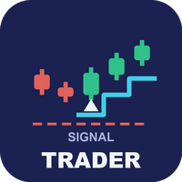</p>

# Signal Trader (MetaTrader 5)

A free Expert Advisor that automates the **closed-bar signals** of UT Bot, SuperTrend or Range Filter: one source at a time, an
ATR stop, a fixed 0.01 lot. It trades live on **one validated combination only**: XAUUSD H4 with SuperTrend. Source, a Python
statement of the three engines and of the trade rule, tests, and the honest result of the screen it came from: **one pass in 444
tests, which is about what chance alone gives**.

**MetaTrader 5 only.** The MT4 port reproduced the EA exactly but **failed its publish gate** (t 1.74 against a required 2.0), so
there is no MT4 edition and no MT4 code here. See [The MT4 gate](#the-mt4-gate-failed).

**Website:** [allanninal.dev/mql5 (Expert Advisors)](https://www.allanninal.dev/mql5/#eas) · [allanninal.dev](https://www.allanninal.dev)
· **Contact:** message me on [LinkedIn](https://www.linkedin.com/in/allanninal/).

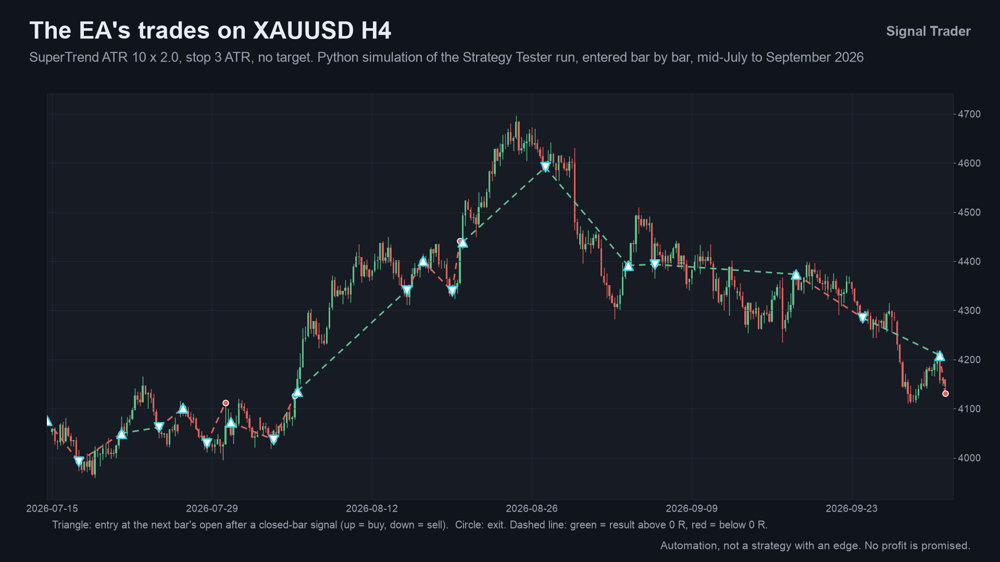

> This EA promises no profit. It automates signals and is not a strategy with a proven edge. Every number here is a backtest.

## Get it on the MQL5 Market

| Edition | Platform | Price | Link |
|---|---|---|---|
| Signal Trader | MT5 | free | <https://www.mql5.com/en/market/product/201967> |
| Signal Trader Pro | MT5 | paid | <https://www.mql5.com/en/market/product/201969> |
| MT4 editions | MT4 | n/a | none: the MT4 port failed its publish gate |

The Market build lists a fourth signal source whose calculation is not part of this repository; the validated preset uses
SuperTrend. The Pro edition is a separate, paid product that is **not** part of this repository (see [Free vs Pro](#free-vs-pro)).

## Contents

1. [What it is and who it is for](#what-it-is-and-who-it-is-for)
2. [Why it was built](#why-it-was-built)
3. [How it works](#how-it-works)
4. [What the screen does and does not show](#what-the-screen-does-and-does-not-show)
5. [The MT4 gate failed](#the-mt4-gate-failed)
6. [How it was tested](#how-it-was-tested)
7. [Architecture](#architecture)
8. [Inputs, the preset, install and compile](#inputs-the-preset-install-and-compile)
9. [Run the Python reference and the tests](#run-the-python-reference-and-the-tests)
10. [Honest limits](#honest-limits)
11. [Free vs Pro](#free-vs-pro)
12. [Licence and credits](#licence-and-credits)

## What it is and who it is for

**What:** the EA reads one signal per closed bar from an embedded engine (UT Bot, SuperTrend or Range Filter), and acts on it at
the next bar's open. An opposite position is closed and reversed, a same-side signal is ignored, otherwise a market order goes out
with a stop of `stop x ATR(14)` of the signal bar and no target by default. The lot is 0.01, or the broker's minimum when that is
larger. One position per symbol and magic number; no grid, martingale or averaging. A panel shows the source, the chart, the preset
state, the last signal and the position.

**Live safety gate:** live, the EA opens orders only on the one **validated preset**: XAUUSD, H4, SuperTrend. On any other symbol,
timeframe or source the panel says "not validated", the EA raises one alert and sends no new orders. The Strategy Tester accepts
any combination so the MQL5 Market validator and you can try it; a result outside the preset is not validated.

**For:** traders who want these standard signals executed by rule on gold H4 and who read the evidence first; developers who want a
small, tested EA with Python statements of its engines.

**Not for:** anyone expecting a proven edge.

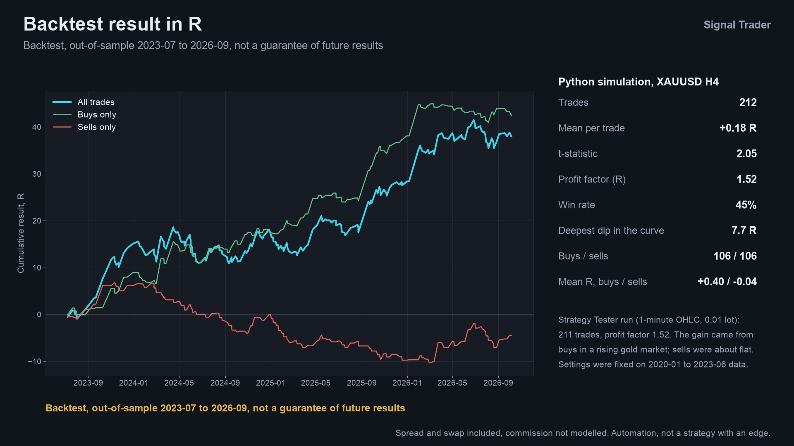

Image notes: both images are drawn by a script from the Python simulation of the Strategy Tester run on broker history; they are
illustrations, not terminal captures.

## Why it was built

The motivations, stated with the evidence we actually have:

- **A screen, run honestly.** Instead of picking a favourite indicator, 444 combinations of symbol, timeframe and signal source were
  tested out of sample with settings frozen in-sample, and the EA ships only for what passed both the Python backtest and the
  MetaTrader 5 Strategy Tester. One combination did.
- **Weak demand, stated plainly.** Our October 2026 market research found that named classic indicators are requested only rarely
  by name, and signal-execution EAs are plentiful. This is a free reference implementation of three standard signals with an
  unusually strict "trade only what passed" rule, not a claim of an unmet need.
- **Provable behaviour.** The three engines and the trade rule are stated in [`tests/reference.py`](tests/reference.py) and compared
  with the research simulation, trade for trade.

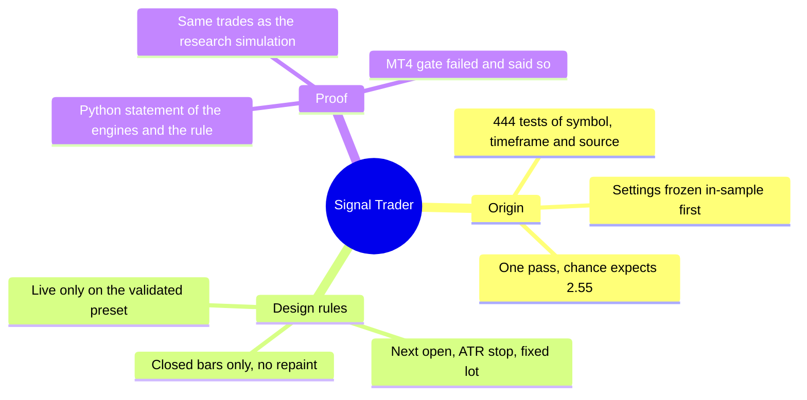

## How it works

### The three signal engines

Each engine is fed one **closed** bar at a time and reports a signal for that bar; the last bar of an array is never signalled.
`ATR_n` is Wilder's RMA of the true range, seeded with the simple average of the first `n` values.

1. **UT Bot** (key `k`, ATR period `n`): `nLoss = k x ATR_n`; the line `T` on the close rises with price and falls with price, never
   against it; buy when `C > T` and `C[1] <= T[1]`, sell on the mirror. Optional: only with the EMA(200) trend.
2. **SuperTrend** (ATR period `n`, multiplier `m`): bands `hl2 -/+ m x ATR_n` that only tighten while the close respects them; the
   trend flips when the close passes the opposite band; a signal is a flip. Optional: only with the EMA(200) trend.
3. **Range Filter** (period `p`, multiplier `m`): `range = EMA(EMA(|C - C[1]|, p), 2p - 1) x m`; the filter moves only when price travels
   more than `range` from it; a signal is the first buy setup after a sell setup (and the reverse).

### The trade rule

1. **Signal** on closed bar `i`. It is acted on at the open of bar `i+1` (or the first tradable tick if the market is closed).
2. **Position.** Opposite: close it at that open and reverse. Same side: ignore. None: open.
3. **Order.** A buy at the ask, a sell at the bid; stop `= fill -/+ stop x ATR(14)` of bar `i` (never closer than the broker's stop and
   freeze levels plus the spread); optional target `= x times the stop distance` (off by default).
4. **Checks.** Refused if the stop would lose more than 50% of equity at 0.01 lot, if free margin is short, if Algo Trading is off,
   or if the market is closed or the preset is not validated (live).

### Per-bar algorithm

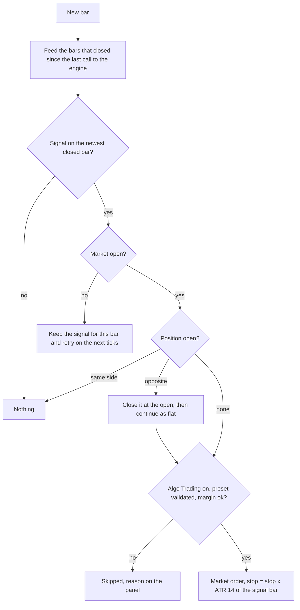

### Position states

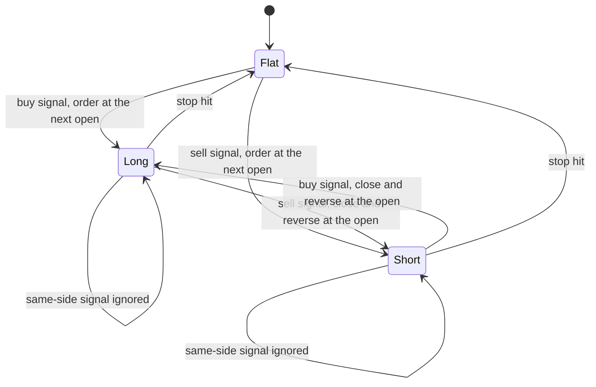

### From signal to order

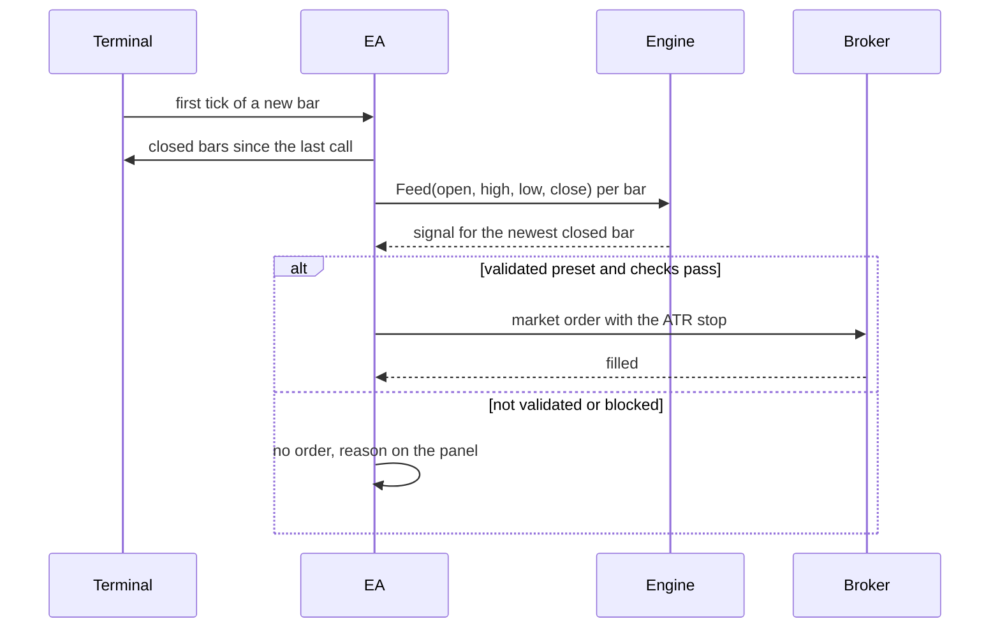

## What the screen does and does not show

Source: [`tests/results/screen-and-tester.md`](tests/results/screen-and-tester.md). Protocol written before any out-of-sample number was
looked at; settings frozen from in-sample data (2020-01 to 2023-06) per test; judged out of sample (2023-07 to 2026-09) on pass
criteria: at least 40 trades, mean R > 0 and t >= 2.0, profit factor >= 1.20, both halves positive, news-pause run still positive; the
Strategy Tester must meet them too.

| Stage | Tests | Passes in Python | Expected by chance |
|---|---:|---:|---:|
| First screen: 8 symbols x H1, H4, D1 x 4 sources | 96 | 1 | 0.76 |
| Extension: 29 more symbols, same rules | 348 | 0 | 1.78 |
| All | 444 | 1 | 2.55 |

```mermaid
xychart-beta
    title "Passes observed vs expected by chance (backtest screen)"
    x-axis ["First 96 tests", "All 444 tests"]
    y-axis "passes" 0 --> 3
    bar [1, 1]
    bar [0.76, 2.55]
```

(First series observed, second expected by chance.) The Holm-adjusted p of the best result is 1.0.

The one pass: **XAUUSD H4, SuperTrend (ATR 10, multiplier 2.0), stop 3 ATR, no target.**

| | trades | mean R | t | PF |
|---|---:|---:|---:|---:|
| In-sample 2020-01 to 2023-06 | | | 0.51 | 1.11 |
| Python, out of sample | 212 | +0.179 | 2.05 | 1.52 |
| MetaTrader 5 Strategy Tester, out of sample | 211 | +0.180 | 2.06 | 1.52 |

Read it with care:

- **About what chance gives.** 444 tests make about 2.55 chance passes; one was observed.
- **Weak in-sample.** The same rule had t 0.51 and PF 1.11 in the setting period.
- **All buys, in a gold rally.** Out of sample: 106 buys earned +0.40 R each, 106 sells -0.04 R each.
- **Fragile neighbours.** ATR 7 gives t 1.57; doubling the spread gives t 2.00.
- **Not evidence of a lasting edge.** It passes the gate that was written down; the listing claims none.

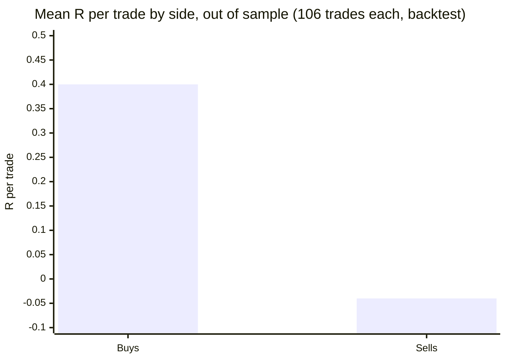

## The MT4 gate failed

The MT4 port reproduced the EA exactly in the MT4 tester (XAUUSD H4, every tick): 212 of 212 signals and 211 of 211 trades identical
to Python, entries 100%, exits 98.6%. But the publish gate judges the MT4 trade list, and it missed criterion 2:

| Run | trades | mean R | t | PF |
|---|---:|---:|---:|---:|
| Python | 211 | +0.184 | 2.09 | 1.53 |
| MetaTrader 5 tester (real per-bar spreads) | 211 | +0.180 | 2.06 | 1.52 |
| MetaTrader 4 tester, two spread chunks (170 then 20 points) | 211 | +0.152 | 1.74 | 1.42 |
| MetaTrader 4 tester, one fixed 170-point spread | 211 | +0.149 | 1.70 | 1.41 |

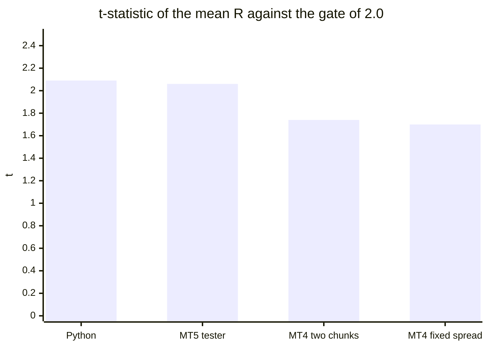

MT4 cannot model real per-bar spreads. By the rule that an EA is published only if it passes both backtests, there is no MT4
edition, and this repository holds no MT4 code.

## How it was tested

| Check | Result |
|---|---|
| Rule invariants on synthetic data, 20 seeds, 3 sources, 11,851 trades ([`tests/check_reference.py`](tests/check_reference.py)) | PASS, 0 violations |
| Reference vs the research simulation, XAUUSD H4 SuperTrend preset, 2023-07 to 2026-10 | 213 of 213 entries identical (bar and side); same exit bar 212 of 213 |
| EA in the MT5 Strategy Tester vs the simulation, preset | 212 / 212 signals, 211 / 211 trades identical, entries 100%, exit bar 100% |
| Same comparison on default settings (EURUSD H1, 2025-26) | UT Bot 548 / 548 signals, SuperTrend 270 / 270, Range Filter 330 / 330; exit bar 98.9 to 99.4% |
| MT5 release check (memory, speed, non-repainting, validator-style runs) | PASS |
| MT5 edition compiled with MetaEditor (clean scratch folder, only this repository's files) | 0 errors, 0 warnings |
| MT5 Market build | passed the MQL5 Market's automated product validation before publication (the Market's own check) |

Sources: [`tests/results/`](tests/results). The EA-in-tester comparisons come from scripts that need the author's private research
environment and broker history, so they are not published; the numbers are as recorded there. Only the reference-vs-simulation
comparison and the synthetic check are reproducible from this repository's code (with your own data for the first).

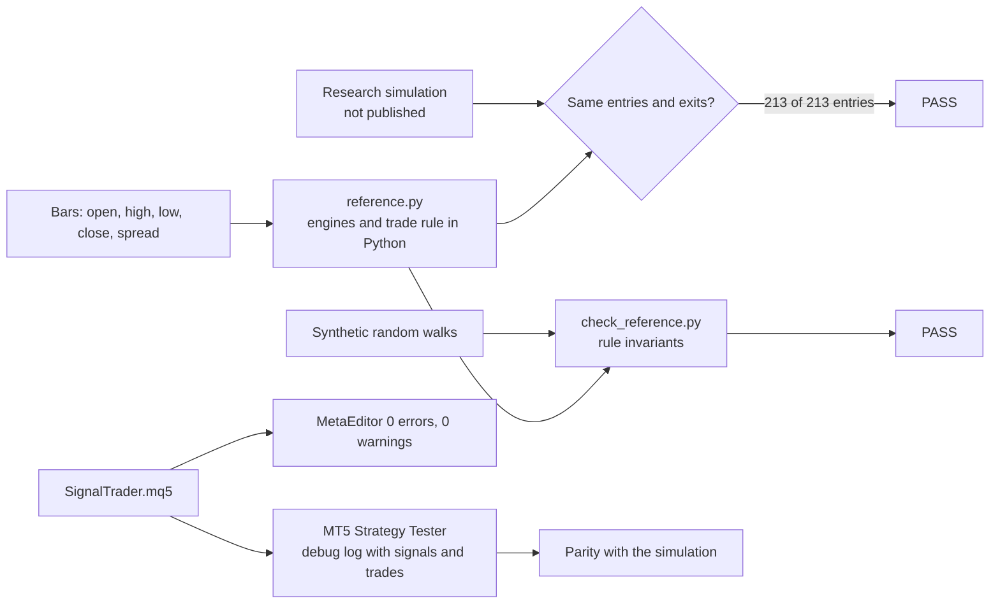

**Not covered:** forward (live) trading, commission and slippage, tick-level fills (the tests use 1-minute OHLC); the three engines
other than SuperTrend have only the default-settings parity runs above and no validated preset.

## Architecture

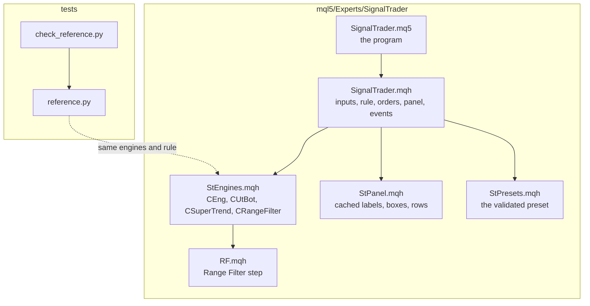

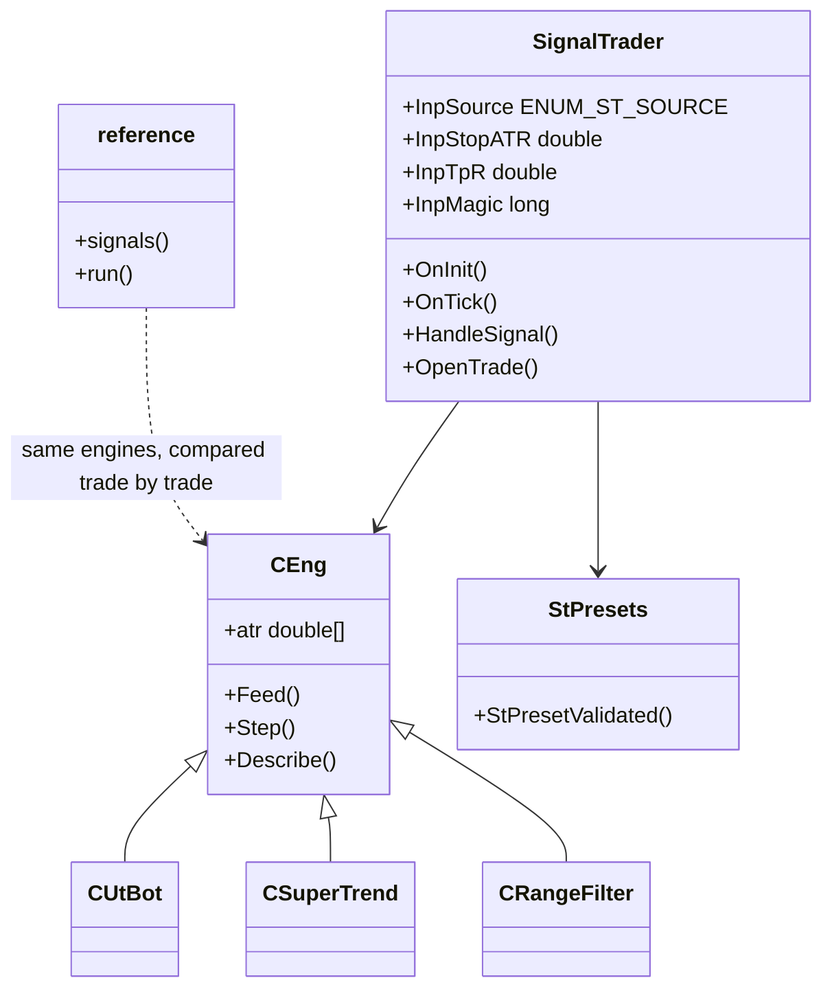

## Inputs, the preset, install and compile

| Input | Default | Meaning |
|---|---|---|
| Signal source | UT Bot | UT Bot, SuperTrend or Range Filter |
| UT Bot: key value, ATR period, EMA(200) trend | 2.0, 10, off | engine settings |
| SuperTrend: ATR period, multiplier, EMA(200) trend | 10, 3.0, off | engine settings |
| Range Filter: sampling period, range multiplier | 100, 3.0 | engine settings |
| Stop loss, x ATR(14) of the signal bar | 2.0 | the stop distance |
| Take profit, x the stop distance | 0 (none) | optional target |
| Magic number; maximum slippage, points | 26101701; 30 | order identity and deviation |
| Show the panel; log every signal and trade | true; false | display and debug (`TRD` and `DBG` lines) |

**The defaults are not the preset.** Load [`presets/SignalTrader_SuperTrend_XAUUSD_H4.set`](presets/SignalTrader_SuperTrend_XAUUSD_H4.set) on an
XAUUSD H4 chart: source SuperTrend, ATR period 10, multiplier 2.0, stop loss 3.0 x ATR. The Preset row on the panel then reads
"validated".

**Install from source.** Copy the `mql5/Experts/SignalTrader` folder into `<terminal data folder>/MQL5/Experts/`, open
`SignalTrader.mq5` in MetaEditor and press Compile (F7): 0 errors, 0 warnings. Keep the files together.

**Account.** Minimum balance suggested by the Market listing: 1,500 USD at 0.01 lot (recommended 3,000 USD). In the out-of-sample
backtest at 0.01 lot the largest drawdown was 638 USD, the largest single loss 272 USD and the widest stop about 450 USD. These are
backtest figures, not a limit on future losses. Test on a demo account first.

## Run the Python reference and the tests

```bash
python3 -m venv .venv && . .venv/bin/activate && pip install -r requirements.txt
python3 tests/check_reference.py                 # synthetic data, no broker history needed; prints PASS or FAIL
```

```python
import sys; sys.path.insert(0, "tests")
from reference import signals, run
# bars: DataFrame indexed by bar open time with open, high, low, close and spread (price units)
sig = signals("st", dict(atr=10, mult=2.0), bars.open, bars.high, bars.low, bars.close)   # +1 / -1 / 0 per closed bar
trades = run(bars, sig, stop_atr=3.0)             # one row per closed trade, gross of swap
```

## Honest limits

- **No edge is shown.** One pass in 444 tests, where about 2.55 were expected by chance, with a weak in-sample result and all of
  the profit from buys in a gold rally. The EA is unproven automation.
- **One validated combination.** Live, nothing else trades; the other sources and symbols have not passed anything.
- **Costs and fills:** the backtests include spread and swap, not commission or slippage; the tester used 1-minute OHLC.
- **MetaTrader 5 only.** The MT4 port exists but failed its gate and is not published.
- **Server clock and symbols:** the validated name may carry a broker prefix or suffix; check that your broker lists XAUUSD.
- No profit or accuracy claim is made.

## Free vs Pro

| | Free: Signal Trader | Paid: Signal Trader Pro |
|---|---|---|
| Platforms | MT5 [201967](https://www.mql5.com/en/market/product/201967) | MT5 [201969](https://www.mql5.com/en/market/product/201969) |
| Price | free | paid (see the Market page) |
| What you get | the signals above, fixed 0.01 lot, ATR stop, the validated preset | the same engines and preset with sizing, confirmation, position management, filters and a news filter, as described on its Market listing |
| Source | this repository | not published |

No need to buy the paid product to use the free one: the free EA is complete on its own.
Website: [allanninal.dev/mql5](https://www.allanninal.dev/mql5/#eas).

## Licence and credits

**Origin of the maths.** The UT Bot idea, an ATR trailing stop on the close, is by **Yo_adriiiiaan** ("UT Bot Strategy" on TradingView),
from an original idea by **HPotter**; the TradingView script **"UT Bot Alerts"** (8 February 2020) is by **QuantNomad**. The SuperTrend
engine follows the widely published TradingView ATR-band script. Range Filter is an own implementation of the published
range-filter method. Thank you to all of them.

**What this means for the licence.** TradingView publishes open-source scripts under the Mozilla Public License 2.0 unless the author
states another licence. I could not retrieve the original scripts' headers to confirm that, so I took the conservative route: the
files that implement the signal maths are licensed **MPL-2.0**:

- `mql5/Experts/SignalTrader/StEngines.mqh`
- `mql5/Experts/SignalTrader/RF.mqh`
- `tests/reference.py`

They are independent implementations in other languages plus additions, but treating them as derived from an MPL-2.0 work is the safe
reading. MPL-2.0 is file-level: changes to those files must stay MPL-2.0 and be shared.

Everything else (the program, the rule and order code, the panel, the preset, tests, docs, images) is © 2026 Allan Niñal under the
[PolyForm Noncommercial License 1.0.0](LICENSES/PolyForm-Noncommercial-1.0.0.md): source-available, free for personal and other
noncommercial use, not for commercial use. Each source file has an `SPDX-License-Identifier` line. Texts: [`LICENSE`](LICENSE),
[`LICENSES/MPL-2.0.txt`](LICENSES/MPL-2.0.txt). The licence applies to this source, not to anything you build or trade with the EA.
Trading involves risk; the software is provided as is.

---

**Website:** [allanninal.dev/mql5](https://www.allanninal.dev/mql5/#eas) · [allanninal.dev](https://www.allanninal.dev)
· Questions: message me on [LinkedIn](https://www.linkedin.com/in/allanninal/).
